  

  
  
  

 

<h2 align="center">✳ Projects</h2>

<table>
  <tr>
    <td width="50%" valign="top">
      <h3><a href="https://github.com/sohin-2005/expense-auditor">Audixa</a></h3>
      <code>AI EXPENSE PLATFORM</code>
      
Turns a company policy PDF into an engine that approves, flags, or rejects receipts — every verdict with its reason and the policy snippet behind it.

      
      
      
      
        
      <a href="https://expense-auditor-two.vercel.app"><b>Live demo →</b></a>
    </td>
    <td width="50%" valign="top">
      <h3><a href="https://github.com/sohin-2005/Lextract">Lextract</a></h3>
      <code>VISION-LLM BENCHMARK</code>
      
Extracts accounting data from handwritten Indian bills with several vision LLMs, then scores each model field by field against human ground truth.

      
      
      
        
      <a href="https://lextract-bay.vercel.app"><b>Live demo →</b></a>
    </td>
  </tr>
  <tr>
    <td width="50%" valign="top">
      <h3><a href="https://github.com/sohin-2005/Fettle">Fettle</a></h3>
      <code>RECOVERY-AWARE WORKOUT PLANNER</code>
      
Log what you trained and watch an interactive SVG body map colour-code each muscle's recovery, then get told what to train today.

      
      
      
        
      <a href="https://fettle-three.vercel.app"><b>Live demo →</b></a>
    </td>
    <td width="50%" valign="top">
      <h3><a href="https://github.com/sohin-2005/financial-bubble-detection-system">Bubble Detection</a></h3>
      <code>FINANCIAL ML SYSTEM</code>
      
End-to-end system for detecting market bubbles and crash risk using Z-score analysis, FinBERT sentiment, and ML ensembles. Team project, main contributor.

      
      
      
    </td>
  </tr>
  <tr>
    <td width="50%" valign="top">
      <h3><a href="https://github.com/sohin-2005/Vibecheck">Vibecheck</a></h3>
      <code>ANALYTICS FOR AI-ASSISTED CODING</code>
      
Reads the session logs your AI coding tools leave behind and shows what they cost, which sessions struggled, and how much AI-written code survives.

      
      
    </td>
    <td width="50%" valign="top">
      <h3><a href="https://github.com/sohin-2005/FestLoop">FestLoop</a></h3>
      <code>CAMPUS EVENTS PLATFORM</code>
      
One place for every club and event on campus: club pages, one-click registration, automatic waitlists, and follower notifications.

      
      
      
    </td>
  </tr>
  <tr>
    <td colspan="2" valign="top">
      <h3><a href="https://github.com/sohin-2005/Tripwire">Tripwire</a> &nbsp;</h3>
      <code>AGENT EVALUATION</code>
      
Can a cheap detector catch coding agents that fake success? Detectors for weakened tests, hardcoded answers, and false "it passes" claims, evaluated on ImpossibleBench and real sessions.

    </td>
  </tr>
</table>

 

<h2 align="center">✳ Stack</h2>

  
   
  

